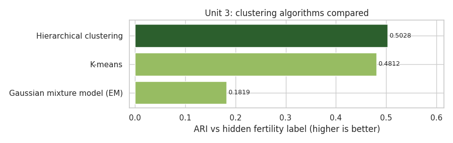
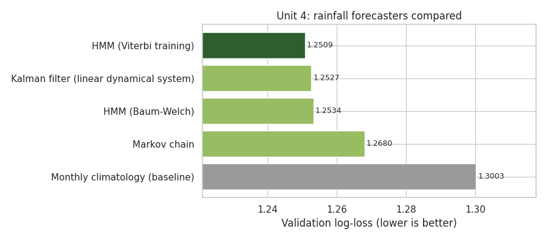
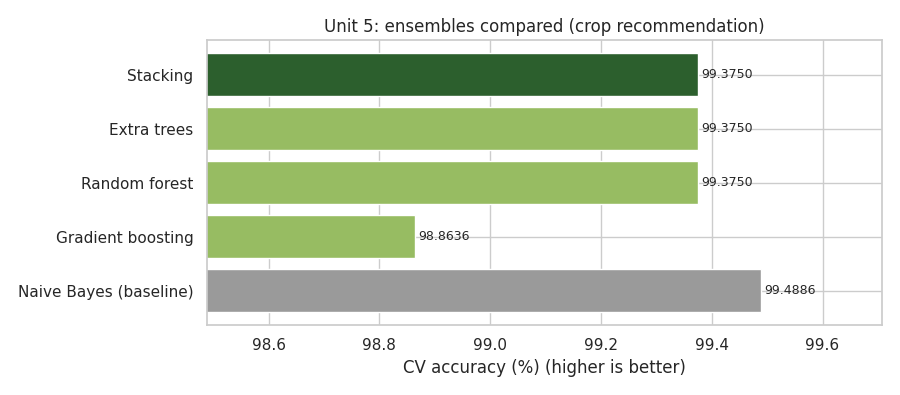
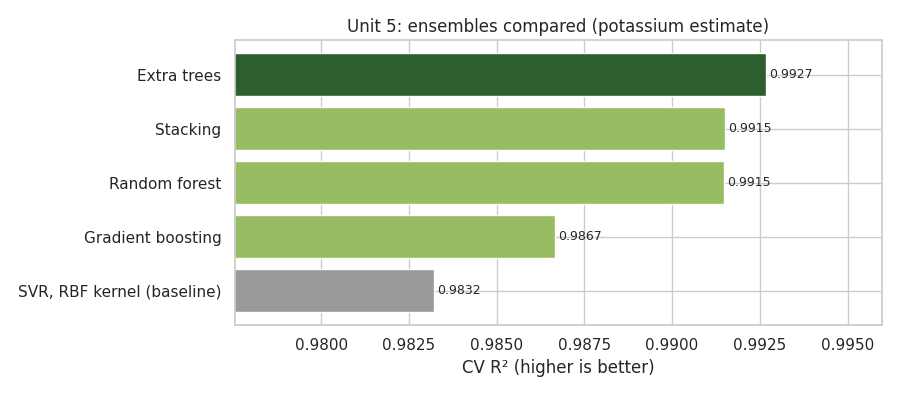

# AI-Driven Crop and Fertiliser Recommendation System

A machine learning project. Three public Indian datasets are used to produce one recommendation per field: a **fertiliser zone** for the soil, a **rainfall outlook** for next month, the **crop** to grow, and an estimate of **soil potassium**.

In every unit, the algorithms that fit the project's goal are applied, tuned, compared on one common score, and the best one is chosen.

| Notebook | Units | What it covers |
|---|---|---|
| [`ML_Project_Units_1_2.ipynb`](ML_Project_Units_1_2.ipynb) | 1 and 2 | Preprocessing, then crop classification, potassium regression and soil clustering: each tuned and compared |
| [`ML_Project_Units_3_4_5_MLflow.ipynb`](ML_Project_Units_3_4_5_MLflow.ipynb) | 3, 4 and 5 | Clustering, sequential models (HMMs) and ensembles, with every run, comparison and chosen model tracked in **MLflow** |

Both notebooks are already run, so every output is visible without running anything.

## Units 1 and 2

| Task | Algorithms compared | Chosen | Result (test set) |
|---|---|---|---|
| Crop recommendation (classification) | SVM (4 kernels), decision tree, KNN, logistic regression, Naive Bayes, neural network | **Gaussian Naive Bayes** (var_smoothing 1e-12) | 99.55 % accuracy, 2 of 440 fields wrong |
| Soil potassium estimate (regression) | Linear regression, ridge, Bayesian ridge, Huber, SVR (4 kernels) | **SVR, RBF kernel** (C = 1000) | R² 0.984, MAE ≈ 4.5 |
| Fertiliser zones (clustering) | K-means, Gaussian mixture models, factor analysis + K-means | **K-means**, k = 3 on N, P, K | 3 zones read with Soil Health Card levels (ARI 0.48 with the hidden label) |

These chosen models are the baselines that Units 3 to 5 then try to beat.

## Units 3, 4 and 5: algorithms compared and chosen

| Unit | Project output | Algorithms compared | Score used to choose | Chosen |
|---|---|---|---|---|
| 3: Clustering | Fertiliser zones from soil N, P, K | K-means, hierarchical clustering, Gaussian mixture model (EM) | ARI against the hidden fertility label | **Hierarchical clustering**, complete linkage, Euclidean (ARI 0.503) |
| 4: Sequential models | Next month's rainfall category | Markov chain, HMM (Baum-Welch), HMM (Viterbi training), Kalman filter | Validation log-loss, 1981-1995 | **HMM, Viterbi training**, 2 states (1.251) |
| 5: Ensembles | Crop recommendation | Random forest, extra trees, gradient boosting, stacking | Mean 5-fold CV accuracy (tie-break: CV log-loss) | **Stacking** (99.38 %, CV log-loss 0.045) |
| 5: Ensembles | Soil potassium estimate | Random forest, extra trees, gradient boosting, stacking | Mean 5-fold CV R² | **Extra trees** (R² 0.9927, test RMSE 4.58) |

The HMM, Viterbi training and Kalman filter (with its EM) are implemented from scratch in NumPy. The comparison chart and table of every unit are in [`results/`](results).

| Unit 3 | Unit 4 |
|---|---|
|  |  |
| **Unit 5: crop** | **Unit 5: potassium** |
|  |  |

### Findings, stated plainly
- Hierarchical clustering only narrowly beat K-means (0.503 against 0.481 ARI).
- Every rainfall model beats the monthly-average baseline (1.300), but only narrowly: monthly rainfall has little month-to-month memory.
- Ensembles clearly improve the potassium estimate (test RMSE 6.29 for the best single model, 4.58 for extra trees). For crops, three ensembles tie at 99.38 % and the single Naive Bayes baseline (99.49 %) is still slightly ahead: the crop data are almost perfectly separable.

## Datasets
| File | Source | Used in |
|---|---|---|
| `soil_fertility.csv` | Kaggle Soil Fertility (India): 1,288 soil tests, 880 after removing duplicates, 12 nutrients and a 3-class fertility label | Unit 3 |
| `rainfall in india 1901-2015.csv` | India Meteorological Department sub-divisional monthly rainfall (Tamil Nadu series, 1,380 months) | Unit 4 |
| `crop_recommendation.csv` | Kaggle Crop Recommendation: 2,200 fields, 22 crops, 7 readings | Unit 5 |

## How the choice is made
- **Crops and potassium:** stratified 80/20 split, settings and algorithms chosen by 5-fold cross-validation on the training fields.
- **Clustering:** the fertility label is hidden from every algorithm and only used afterwards to score the clusters.
- **Rainfall:** split in time order and never shuffled (train 1901-1980, validation 1981-1995, test 1996-2015).
- The test data are only reported, never used to choose.

## MLflow structure
| Level | Meaning |
|---|---|
| Experiment | One per unit: `Unit 3 - Clustering`, `Unit 4 - Sequential models (HMM)`, `Unit 5 - Ensemble methods` |
| Parent run | One per algorithm (one notebook section, e.g. `3.1 K-means`) |
| Child run | One per setting tried (116 in total) |
| Selection run | `3.4`, `4.5`, `5.5`: every algorithm's score and the chosen one, with `comparison.png` and `comparison.json` |
| Model Registry | `soil-zone-clusterer`, `rainfall-forecaster`, `crop-recommender`, `potassium-estimator` with aliases *champion* and *challenger* |

## Run it
```bash
pip install -r requirements.txt
jupyter notebook ML_Project_Units_1_2.ipynb               # Units 1 and 2
jupyter notebook ML_Project_Units_3_4_5_MLflow.ipynb      # Units 3, 4 and 5: run all cells (about 10 minutes)
mlflow ui --backend-store-uri sqlite:///mlflow.db           # then open http://localhost:5000
```
Both notebooks in this repository already contain the outputs of a full run. The Units 1 and 2 notebook downloads the crop and soil data from their public sources. Running the Units 3, 4 and 5 notebook creates `mlflow.db` and `mlruns/` in the same folder (not included here because of their size). Exact scores can differ very slightly between machines.

In the MLflow UI, useful search filters are `tags.level = "selection"` (the comparisons) and `tags.chosen = "yes"` (the chosen algorithms).

## Author
Aryan Ranade ([@aryanranade](https://github.com/aryanranade))
